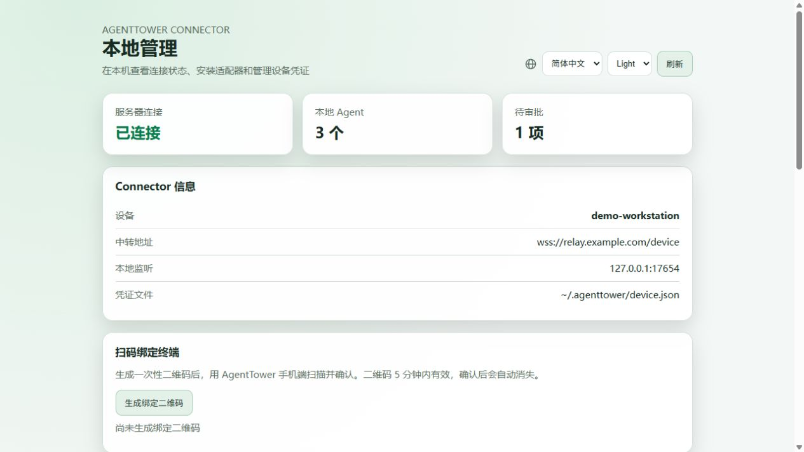
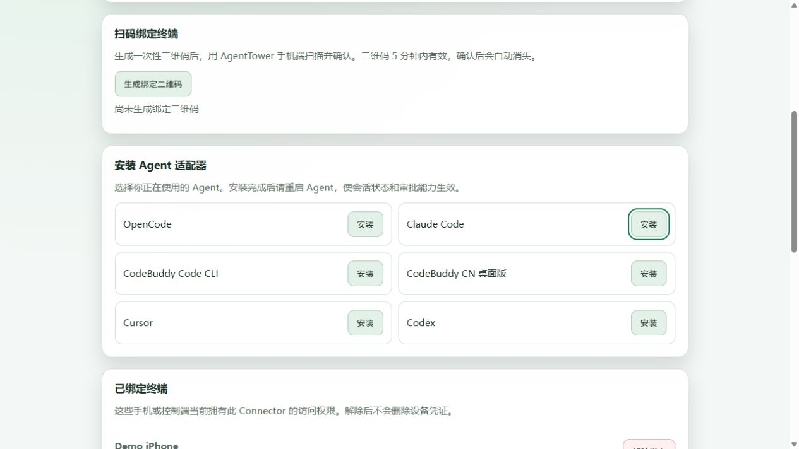
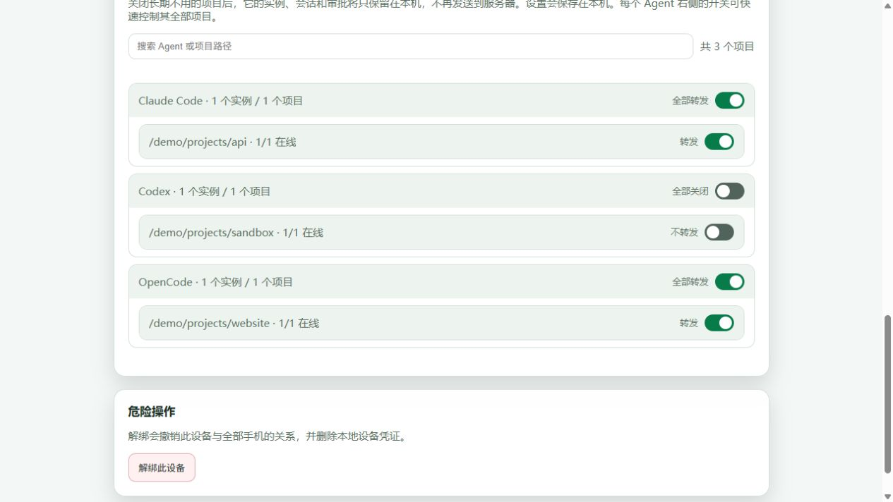

# AgentTower Agent Connector

**Step away from your computer. Stay close to your AI coding agents.**

[简体中文](README.md) · [Server source](https://github.com/agenttower-ai/agent-tower-server) · [Flutter client source](https://github.com/agenttower-ai/agent-tower-client) · [iOS App Store](https://apps.apple.com/app/id6820363505)

AgentTower brings agent status, conversations and supported actions to a control client. This repository contains the **Go connector that runs on your computer**. It integrates Claude Code, Codex, Cursor, OpenCode, CodeBuddy and DeepSeek Harness, and connects them to a relay so you can follow work and handle supported approval requests away from your desk.

## Related projects

| Project | Role |
| --- | --- |
| [Agent Connector](https://github.com/agenttower-ai/agent-connector) | Runs on the computer with your AI agents; syncs status and supported operations |
| [Agent Tower Server](https://github.com/agenttower-ai/agent-tower-server) | Pairs devices, manages access and relays messages |
| [Agent Tower Client](https://github.com/agenttower-ai/agent-tower-client) | Flutter client for progress, conversations and supported approvals |

Use all three with the same relay for a complete self-hosted setup. Agent capabilities vary by adapter.

## When would I use it?

| Situation | What Connector does |
| --- | --- |
| Get coffee while a long task runs | Forward agent status and supported session information |
| An agent needs permission while you are away | Relay supported approval requests to an authorized client and send decisions back |
| Follow work across several computers | Run a connector on each computer and connect compatible clients through the same service |
| Choose which projects share activity | Manage connections, client access and project forwarding from the local management page |

Capabilities vary by adapter. Not every agent supports conversation continuation or approvals. Check the adapter's declared capabilities and the client UI. Tasks run on the original computer, which must remain on with the agent running.

## Supported agents

Run `./agenttower install <name>` beside the Connector executable (`agenttower.exe` on Windows). These integrations have adapter code in this release; this is not a claim that every upstream version and platform has been verified.

| Agent / integration | Installation name | Capabilities and limits |
| --- | --- | --- |
| OpenCode / OpenCode CLI | `opencode` / `opencode-cli` | Plugin status, sessions and approvals; session operations declared by the plugin |
| Claude Code | `claude` | Hook status and `PermissionRequest` approvals; no remote session control declared |
| Cursor / Cursor CLI | `cursor` / `cursor-cli` | Hooks, history and Shell/MCP approvals; session control when its bridge is available |
| Codex CLI | `codex` / `codex-cli` | `notify` status notifications only; this does not provide remote approval or conversation control |
| Codex desktop projects / app-server | Discovered by Connector; install `codex` separately for CLI notifications | Project discovery; history and session control when app-server is available; no remote approval declared |
| CodeBuddy Code CLI | `codebuddy` / `codebuddy-cli` | Hook status and Bash/MCP approvals; confirm installation in `/hooks` |
| CodeBuddy CN Desktop | `codebuddy-desktop` | Local history and workspace discovery; session control with the desktop bridge connected; no remote approval declared |
| DeepSeek Harness | `dsh` | Plugin status, session control and tool approvals; launch with `--patch` as directed by installation output |

Restart the agent after installation. Desktop bridges and history discovery depend on the locally installed tool, its runtime and its data formats. Show only capabilities actually declared by the connection. Reserved brand icons do not indicate additional supported integrations.

## Three screenshots

### 1. Connection overview



### 2. Adapters and client access



### 3. Project forwarding



These are the actual Connector local Web management screens, populated with synthetic demo data. Open `http://127.0.0.1:17654/` on the computer running Connector. View relay status and local agents, install adapters, review paired clients, and control forwarding per agent or project. Disabling forwarding does not stop agent tasks or erase previously forwarded data. This local page is not a public management endpoint.

## How it works

```text
Local AI agent ↔ Connector (this repository) ↔ AgentTower Server ↔ Compatible client
```

Connector runs on Windows, macOS or Linux and initiates an outbound relay connection. Server manages pairing, access relationships and message forwarding. The client displays progress and sends supported operations.

## Build and verify

Requires Go 1.23 or later. From the repository root:

```sh
go mod download
go build -trimpath -o agenttower ./connector
go test ./connector -skip TestCodebuddyDesktopSessionsFromRealLayout
```

On Windows, use `agenttower.exe` as the output name. The compiled connector does not require Node.js. The excluded test needs a real local CodeBuddy installation and discoverable session history; verify it separately in that environment.

## Connect your agent

```sh
./agenttower start --server https://relay.example.com --name "My computer"
./agenttower install opencode
```

Replace the example URL with your relay. Install the adapter you need, restart the agent, and confirm pairing from a compatible client connected to that relay. The source release defaults to an example address, not a production service.

Installation entries: `opencode`, `opencode-cli`, `claude`, `cursor`, `cursor-cli`, `codex`, `codex-cli`, `codebuddy`, `codebuddy-cli`, `codebuddy-desktop`, `dsh`. Codex CLI notify provides status notifications only. Load the DSH plugin with `--patch` as directed by the installation output. Adapter installation changes the agent's user-level configuration; read the output before proceeding.

The local management page listens on `127.0.0.1:17654`. Device configuration is stored in `~/.agenttower/device.json` and contains credentials. Do not publish it. Traffic is not end-to-end encrypted: the relay can read forwarded content. Never publish real sessions, credentials or production configuration.

## Scope and license

This repository includes Connector source, embedded adapters and tests. Server and Flutter client source are maintained in separate repositories. Production deployment configuration is excluded.

The [license](LICENSE) is **MIT with additional attribution-preserving terms**, not standard MIT. Commercial use, modification and redistribution are allowed without requiring disclosure of your business source or modifications. Preserve copyright notices, the full license and existing AgentTower attribution in service identifiers; you may add your own product name alongside it. Refer to the complete license for the terms.

Dependencies retain their own licenses; see [THIRD_PARTY.md](THIRD_PARTY.md). To contribute, see [CONTRIBUTING.md](CONTRIBUTING.md). For sensitive reports, follow [SECURITY.md](SECURITY.md).
