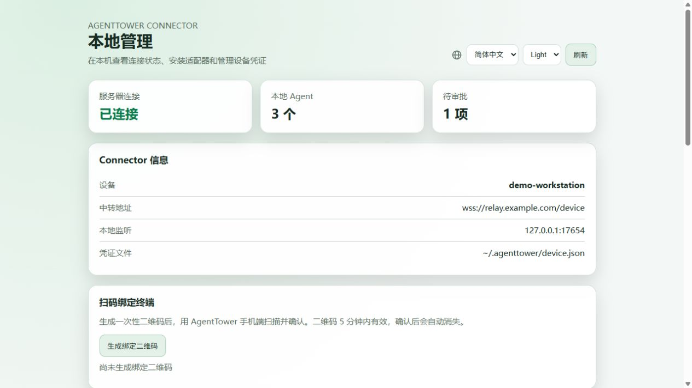
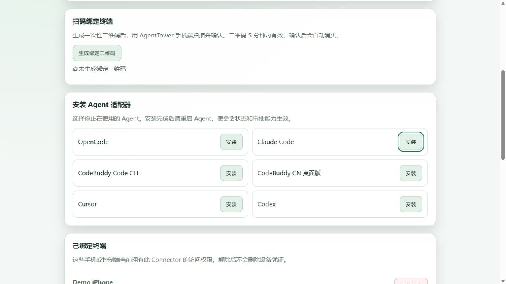
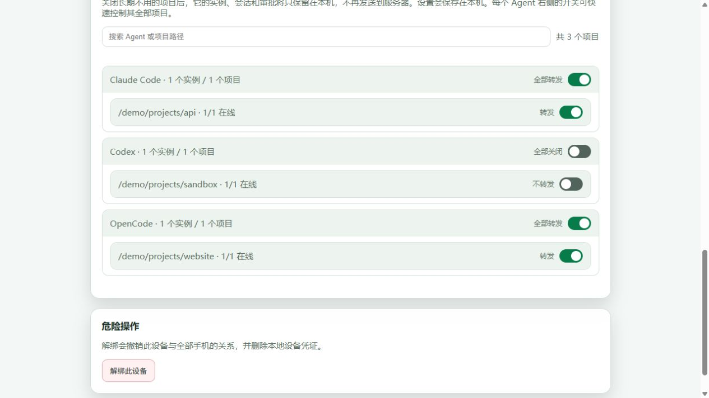

# AgentTower Agent Connector

**离开电脑，也能掌握 AI 编程 Agent 的进展。**

[English](README.en.md) · [Server 源码](https://github.com/agenttower-ai/agent-tower-server) · [iOS App Store](https://apps.apple.com/app/id6820363505)

AgentTower 把电脑上的 AI Agent 状态、会话和受支持的操作带到控制客户端。这个仓库是运行在电脑上的 **Go 连接器**：接入 Claude Code、Codex、Cursor、OpenCode、CodeBuddy 和 DeepSeek Harness，通过中转服务与客户端通信，让你在离开工位后仍能了解任务进展、处理支持远程审批的请求。

## 下载与自动发版

预编译安装包见 [GitHub Releases](https://github.com/agenttower-ai/agent-connector/releases)。平台支持、签名和自动发版步骤见 [发行说明](docs/RELEASING.md)。首次使用请配置自己的中转服务器。

## 关联项目

| 项目 | 负责什么 |
| --- | --- |
| [Agent Connector](https://github.com/agenttower-ai/agent-connector) | 运行在 Agent 所在的电脑，同步状态与受支持的操作 |
| [Agent Tower Server](https://github.com/agenttower-ai/agent-tower-server) | 设备绑定、访问授权和消息中转 |
| [Agent Tower Client](https://github.com/agenttower-ai/agent-tower-client) | Flutter 客户端，查看进展、会话并处理受支持的审批 |

完整自托管需要三者连接同一个中转服务；各 Agent 的可用能力取决于适配器。

## 一眼了解

| 你想做什么 | Connector 的作用 |
| --- | --- |
| 长任务执行时去喝杯咖啡 | 同步 Agent 状态与受支持的会话信息 |
| Agent 等待操作确认时不守在电脑前 | 将适配器支持的审批请求转发到已授权客户端，并回传决定 |
| 照看多台电脑上的任务 | 每台电脑运行 Connector，通过同一个服务连接兼容客户端 |
| 控制哪些项目向外转发 | 在本机管理页查看连接、管理授权及项目转发 |

各工具的能力不同，不保证每个 Agent 都支持会话续接或审批；以适配器声明和界面展示为准。任务仍在原电脑执行，电脑与 Agent 必须保持运行。

## 支持的 Agent

在 Connector 所在目录执行 `./agenttower install <名称>`（Windows 使用 `agenttower.exe`）。下列为当前已有适配代码的工具；不代表所有版本和平台都已逐一验收。

| Agent / 接入方式 | 安装名称 | 能力与限制 |
| --- | --- | --- |
| OpenCode / OpenCode CLI | `opencode` / `opencode-cli` | 插件同步状态、会话与审批；支持插件声明的会话操作 |
| Claude Code | `claude` | Hooks 状态与 `PermissionRequest` 审批；不声明远程会话控制 |
| Cursor / Cursor CLI | `cursor` / `cursor-cli` | Hooks、历史读取与 Shell/MCP 审批；可用桥接时提供会话控制 |
| Codex CLI | `codex` / `codex-cli` | `notify` 状态通知；不能据此宣称支持远程审批或对话 |
| Codex 桌面项目 / app-server | 随 Connector 自动发现，CLI 通知可另装 `codex` | 发现项目；可用 app-server 时读取历史并控制会话；不声明远程审批 |
| CodeBuddy Code CLI | `codebuddy` / `codebuddy-cli` | Hooks 状态与 Bash/MCP 审批；安装后在 `/hooks` 确认 |
| CodeBuddy CN 桌面版 | `codebuddy-desktop` | 本地历史及工作区发现；桌面桥连接时提供会话控制；不声明远程审批 |
| DeepSeek Harness | `dsh` | 插件状态、会话控制与工具审批；启动时按安装输出加入 `--patch` |

安装后重启对应 Agent。桌面桥与历史发现依赖对应工具在本机安装、运行及其本地数据格式。UI 只应展示连接实际声明的能力；预留图标不代表已经支持其他 Agent。

## 三张截图

### 1. 本地连接概览



### 2. 适配器与终端授权



### 3. 项目转发



以上为 Connector 实际本机 Web 管理界面，使用虚构演示数据。在运行 Connector 的电脑上打开 `http://127.0.0.1:17654/`，即可查看中转连接和本地 Agent、安装适配器、管理已绑定终端，并按 Agent 或项目控制转发。关闭转发不会停止 Agent 任务，也不会删除此前已转发的数据。管理页仅在本机访问，不作为公网管理入口。

## 工作方式

```text
本机 AI Agent ↔ Agent Connector（本仓库）↔ AgentTower Server ↔ 兼容控制客户端
```

Connector 运行在 Agent 所在的 Windows、macOS 或 Linux 电脑上，主动连接中转。Server 负责设备绑定、授权关系与消息转发，客户端负责展示进展及发起受支持的操作。

## 开源范围与许可

AgentTower 独立 Go 连接器，采用 [MIT + 标识保留补充条款](LICENSE) 自定义许可。允许商用、修改和分发，不要求公开业务源码或修改代码；必须保留版权、完整许可及服务标识中已有的 AgentTower 来源信息，可并列添加自己的产品名称。这不是标准 MIT 许可。

连接本机 AI 编程 Agent 与自行指定的中转，提供状态同步及受支持的会话、历史和审批能力。各 Agent 能力不同，以实际声明为准。

本仓库只包含 Connector 源码、嵌入式适配器和测试。手机端、服务端、品牌图标及生产部署配置不包含在内。

## 构建与验证

需要 Go 1.23 或以上版本。在仓库根目录运行：

```sh
go mod download
go build -trimpath -o agenttower ./connector
go test ./connector -skip TestCodebuddyDesktopSessionsFromRealLayout
```

Windows 可将输出名称改为 `agenttower.exe`。编译后的程序无需 Node.js。

`TestCodebuddyDesktopSessionsFromRealLayout` 需要真实的本机 CodeBuddy 安装和可发现的历史会话，应另行验收。

## 使用

```sh
./agenttower start --server https://relay.example.com --name "My computer"
./agenttower install opencode
```

必须将示例地址替换为自己的中转服务。开源发行的默认地址仅为示例，不连接生产服务。安装需要的适配器后重启对应 Agent，通过连接同一服务的兼容客户端确认绑定码。

安装入口包括 `opencode`、`opencode-cli`、`claude`、`cursor`、`cursor-cli`、`codex`、`codex-cli`、`codebuddy`、`codebuddy-cli`、`codebuddy-desktop`、`dsh`。Codex CLI notify 仅提供状态通知；DSH 插件需按安装输出以 `--patch` 加载。安装命令会修改对应 Agent 的用户级配置，请查看命令输出。

默认仅监听 `127.0.0.1:17654`，主动连接中转。配置默认保存在 `~/.agenttower/device.json`，包含设备凭证，不得公开。没有端到端加密，中转可读取转发内容。不要提交真实会话、凭证或生产信息。

依赖遵循各自许可证，参见 [THIRD_PARTY.md](THIRD_PARTY.md)。
